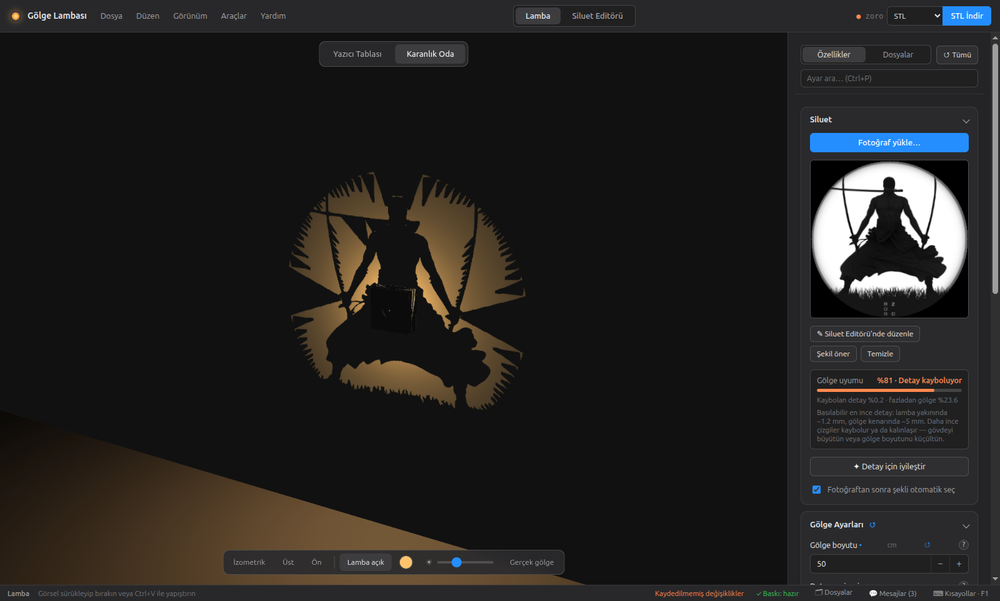
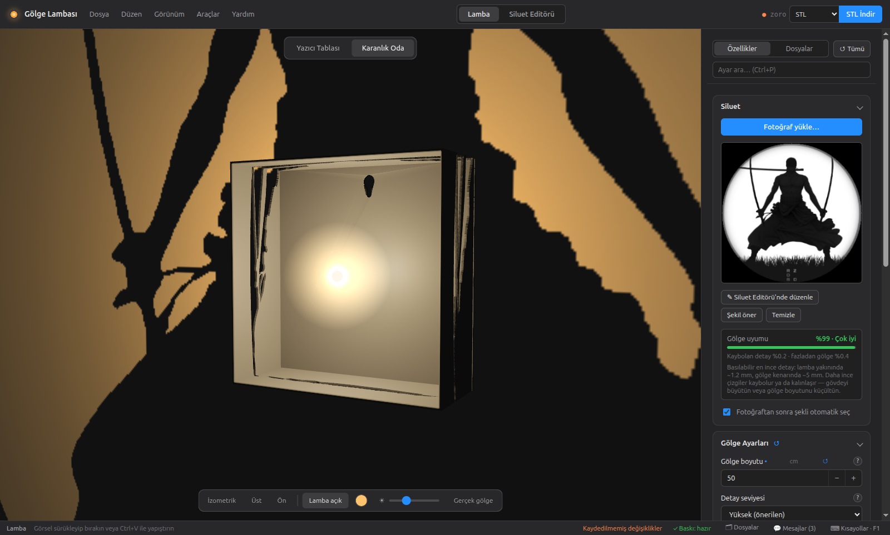
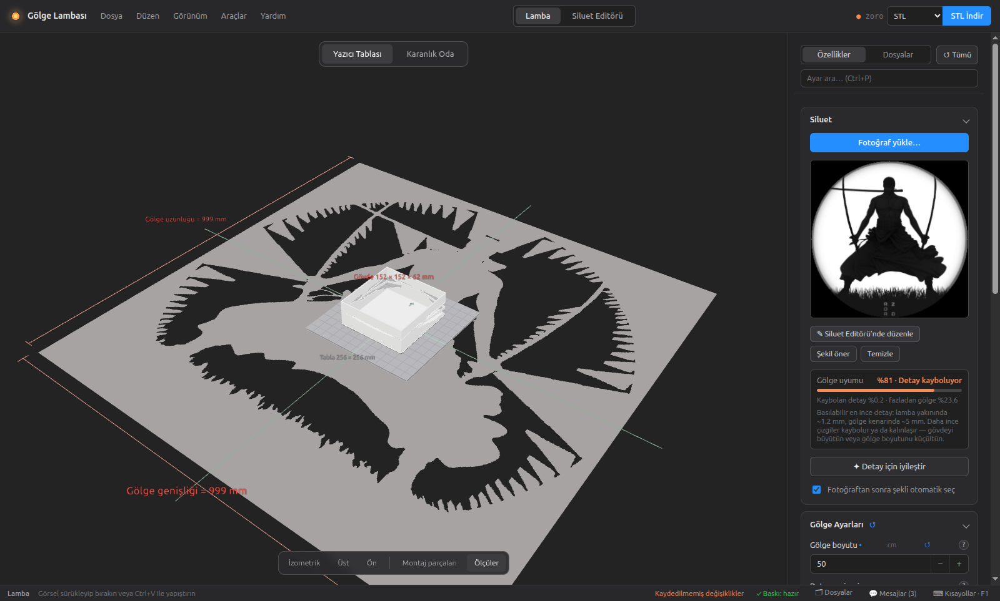
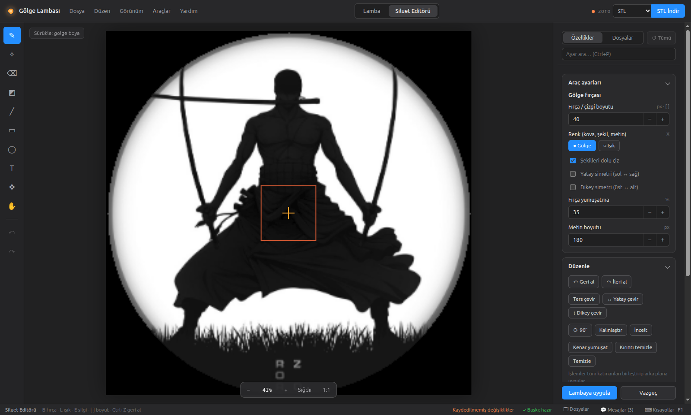
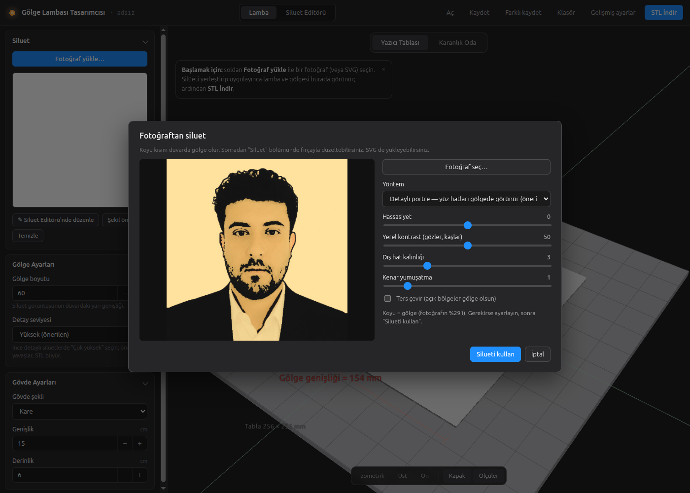

# Shadow Box Designer — Gölge Lambası Tasarımcısı

**English** | [Türkçe](README.tr.md)

> **AI agents / geliştiriciler:** start with [`CLAUDE.md`](CLAUDE.md) / [`AGENTS.md`](AGENTS.md); [`docs/README.md`](docs/README.md) maps every other doc (architecture, design rules, known issues, per-module APIs).

Desktop app that turns a **photo into a wall-mounted shadow lamp**. It pulls the silhouette out of the photo, designs a lamp body (square, rectangle, cylinder, hexagon, star, flower, heart…) with the light in the middle, and computes the wall cutouts so that when the lamp is on, the silhouette appears on the wall as if drawn there. The result is **one model file** (STL, 3MF, OBJ, FBX, PLY or GLB), ready to print. No SVG step is needed. The interface is in Turkish by default and can be switched to English (View → Dil / Language).



**Contents:** [Features](#features) · [Download and install](#download-and-install) · [Quick start](#quick-start-5-minutes) · [Printing your lamp](#printing-your-lamp) · [Screenshots](#screenshots) · [Workflow in detail](#workflow) · [Troubleshooting](#troubleshooting) · [Project layout](#project-layout) · [Licence](#author-and-licence)

## Features

- **Photo → silhouette** in one click: quick (plain background), AI background removal, or a detailed portrait that keeps hair, eyes and beard.
- **Any body shape:** square, rectangle, rounded rectangle, cylinder, polygon, star, flower, heart; with taper and adjustable depth.
- **What you see is what you print:** the dark-room preview, the wall strip and the accuracy score all use the exact geometry that gets exported.
- **Shadow match score (Gölge uyumu)** tells you how close the real shadow will be to your silhouette, and **Detay için iyileştir** tunes the detail level and print mode for you (your body size is kept).
- **Print-ready meshes:** watertight, nothing floating, fits your printer bed (warns if not); one-piece upright print or flat glued panels.
- **Built-in silhouette editor** (brushes, shapes, text, layers, symmetry, undo) and an **image converter** for logos and drawings.
- **Exports** STL, 3MF, OBJ, FBX, PLY, GLB, plus SVG/PNG from the converter.

## Download and install

You need **[Node.js](https://nodejs.org/) 20 LTS or newer** and **Git** (or just download the ZIP). Works on Linux, Windows and macOS.

```bash
git clone https://github.com/kerim47/ShadowLightBox.git
cd ShadowLightBox
npm install
npm start
```

No Git? Click **Code → Download ZIP** on GitHub, unzip it, open a terminal in that folder and run `npm install` then `npm start`.

Want an installer instead? `npm run build:win`, `npm run build:mac` or `npm run build:linux` writes one into `dist/`.

If `npm start` fails, see [Troubleshooting](#troubleshooting).

## Quick start (5 minutes)

1. **Open the sample.** On first launch a sample design is copied into your designs folder: **Dosya → Aç…** → `zoro`. (Or drag [`electron/samples/zoro.json`](electron/samples/zoro.json) onto the window.)
2. **Look at it.** Switch between **Yazıcı Tablası** (printer bed, `Alt+1`) and **Karanlık Oda** (dark room, `Alt+2`). In the dark room the toolbar's **Ön** button shows the wall straight on.
3. **Use your own photo.** **Fotoğraf yükle…** in the Inspector (or drag a photo onto the window), pick a method, place the silhouette, click **Yerleştirmeyi uygula**.
4. **Check the score.** Aim for a green **Gölge uyumu** (≥ 90 %). If it is low, click **Detay için iyileştir**.
5. **Download.** Choose the format next to the download button and click **İndir** (`Ctrl+E`). Files go to your **Downloads** folder.

## Printing your lamp

| Setting | Default | What to do |
|---|---|---|
| Baskı şekli (print mode) | Tek parça (one piece, upright) | Print upright with **supports enabled in your slicer** (Cura / PrusaSlicer / Bambu Studio; *tree* supports are easiest to remove). |
| Desteksiz baskı (support-free) | **Off** | Turn on only for compact silhouettes. It adds small roofs under overhangs; far from the lamp they show as saw teeth on the wall. |
| Düz paneller (flat panels) | – | For polygon bodies: each side prints flat without supports, then you glue them. Good for very fine detail. |
| Duvar kalınlığı (wall) | 2 mm | Thicker is sturdier; the minimum is 0.8 mm. |
| Tabla X / Y / Z | 250 mm | Set your printer's build volume; the bed view warns if the body doesn't fit. |

- **Material:** opaque, dark PLA or PETG works best (white or translucent filament lets light through the walls).
- **Light:** a small single-chip LED (1–3 W, warm white, ≥ 120°), see [Which light?](#which-light). Bulbs give blurry shadows.
- **Light parts** (front cap / LED holder, tube holder) are hidden in the previews and left out of downloads by default. Show them on the bed with **Montaj parçaları** and include them in the download dialog if you want to print them too.
- **Mounting:** the base plate goes against the wall; hang it on a screw through the keyhole. The picture appears on the wall around the lamp, **Gölge boyutu** sets its half-width.

## Screenshots

All taken with the bundled `zoro.json` sample and default settings.

| | |
|---|---|
|  |  |
| **Karanlık Oda:** shadow on the wall, 99 % match | **Open front:** only the printed body and the light |
|  |  |
| **Yazıcı Tablası:** body on the bed with dimensions | **Siluet Editörü:** retouch the silhouette |

## Workflow

1. **Photo → silhouette.** Choose a photo, then pick a method:
   - *Detailed portrait* (default) keeps facial detail. The background is separated (AI if available). Inside the person, dark areas (hair, brows, eyes, beard, dark clothes) become shadow and light areas become lit, like a stencil. An optional outline separates a light face from a light background.
   - *Quick* finds the background colour from the photo's border. Works well on plain backgrounds, needs no model.
   - *AI background removal* works on any photo. It uses the IS-Net general-use model (Apache-2.0), downloaded once (~170 MB) into the app data folder. If that download fails, the app falls back to the small U²-Net-p model.
   - Sensitivity, smoothing, invert and "solid silhouette" options let you fix edge cases.
2. **Place it.** Drag and scroll to position the silhouette. The orange cross is the light and the red outline is the lamp body. Detail is finest near the lamp and gets coarser further out (magnification t = ρ/r), so put the lamp close to the most detailed part. For portraits that usually means the middle of the face. Then click **Yerleştirmeyi uygula**. Retouch in the **Siluet Editörü** (click the thumbnail).
3. **Body shape.** The app suggests a shape from the silhouette's proportions (tall → portrait rectangle, compact and round → cylinder, …). You can change it any time.
4. **Download the lamp.** Pick the format next to the download button (STL, 3MF, OBJ, FBX, PLY or GLB) and click **İndir** (`Ctrl+E`).



### Helping the extraction (photo window)

- **▭ Detay alanı (A):** draw a box around something the algorithm missed (a sword behind the character…). The whole photo is still processed as usual; inside each box the dark lines are searched again with local contrast and **added** to the result, so the object keeps its own edges instead of becoming a black box. Several boxes are allowed; `Ctrl+Z` removes the last one.
- **🖌 Ekle (E) / ⌫ Çıkar (R):** paint roughly over a part that was missed (a sword behind the character, a strand of hair) or over something unwanted. In the portrait method the painted area joins the subject, and its dark lines and outline become shadow; in the flat methods it becomes solid shadow or light.
- Boxes and brush strokes never re-run the AI model.

## Fine detail

- **Reset to default (↺):** every changed setting shows a ↺ next to its name (hover: the default value); each section header has a ↺ for the whole group and the Inspector header has **↺ Tümü**. All of them can be undone with `Ctrl+Z`.
- **File picker:** on the desktop app every "open file" uses an in-app picker (places, folders, filter, image preview, keyboard). The system GTK dialog crashed Electron on Linux (`GLib-GObject … no handler with id` → SIGTRAP), so it is never opened.
- **One view.** Every setting is always visible in the Inspector (no simple/advanced mode); sections are collapsible and searchable (`Ctrl+P`).
- **Printer bed:** Baskı Ayarları starts with **Tabla genişliği (X)**, **Tabla derinliği (Y)** and **Baskı yüksekliği (Z)**. The bed view draws that rectangle and warns when the body doesn't fit (either orientation). Old designs with a single bed size open as a square bed.
- The light parts (front cap, LED holder, tube holder) are hidden by default: the bed shows only the lamp body (toolbar **Montaj parçaları** shows them) and the dark room shows just the printed body and the light itself, with the front left open. They are left out of downloads unless you include them.
- **Detail pipeline.** Silhouettes are processed at 2048 px. Small parts such as letters, twig tips and gaps between fingers are kept, and edges stay anti-aliased, so the wall grid resolves sub-pixel edges. Detail levels go up to "Çok yüksek" (≈650k cells).
- **Gölge uyumu.** Shows how well the shadow the lamp will actually cast matches the silhouette (IoU), plus lost detail, extra shadow, and the finest printable detail near the lamp and at the shadow edge.
  - Why there is a limit: a feature on the wall shrinks by t = ρ/r on the lamp wall, and the printer can't print lines much thinner than ~0.8 mm.
- **Detay için iyileştir.**
  - Never changes the body's width and height. Applies print-only settings itself (support-free off when roofs hurt, "Çok yüksek", flat panels).
  - Measures and suggests the big levers, each with its gain and an **Uygula** button (or **Hepsini uygula**): more depth (the light further from the wall magnifies the shadow less), transparent tube mount, a slightly smaller shadow, an LED with a ≤ 1 mm emitter.
- **LED yayıcı çapı** (Karanlık Oda settings, default 2 mm): the preview and the score use a real disk-shaped LED, so shadow edges soften like in real life (more towards the outer shadow). The score box also shows the **edge (fine detail) match** and how many edges are blurred.
- Hole walls are cut along the light rays, so wall thickness does not narrow the shadow.
  - Also compares print modes: upright support-free, upright with slicer supports, and flat panels + 0.2 mm layer.
  - Picks the combination with the best match and explains the choice. For very detailed art, flat panels usually win, because they need neither roofs nor bridges.

## Image converter (Görsel Dönüştürücü)

An optional extra tool, kept out of the main photo → lamp flow: open it from **Araçlar → Görsel Dönüştürücü** (`Ctrl+Shift+G`). It turns a photo, logo, drawing or SVG into a **print-ready** stencil and SVG:

- **Methods:** brightness threshold (Otsu or local), colour layers (k-means; click a swatch to make it shadow), line art (edges), subject silhouette (quick or AI) and detailed portrait.
- **Placement** happens directly in the shadow frame of the current lamp; the red dashed outline is the body.
- **3D-print check:** the stencil is mapped onto the unrolled lamp wall and measured in real millimetres there. Shadow parts not connected to the base (they would float in the print) get a bridge, lines thinner than the minimum (default 2 × nozzle) are thickened, and narrow light gaps are closed or widened. The **Baskı analizi** view shows what changed; **Basılacak gölge** shows the shadow computed from the lamp's real wall field.
- **Output:** SVG at real wall size in cm (one "Ayrıntı" choice: high / balanced / light), PNG, or **Lambaya uygula** (`Ctrl+Enter`).
- Exports (lamp models, SVG, PNG, JSON) are written straight to the **Downloads** folder; the toast has a "Klasörde göster" button.

## Menus, shortcuts, drag and drop

- Menu bar: **Dosya · Düzen · Görünüm · Araçlar · Yardım**. `F1` lists every shortcut.
- Common shortcuts: `Ctrl+N/O/S/Shift+S` new/open/save/save as, `Ctrl+Z/Y` undo/redo (lamp settings and silhouette, or converter settings), `Ctrl+E` download the lamp in the selected format, `Ctrl+1/2` Lamba / Siluet Editörü, `Ctrl+Shift+G` image converter, `Alt+1/2` bed/dark room.
- **Layout (like Unity):** the scene/view is on the left, the **Inspector** with all settings is on the right in every workspace. Its header has **Özellikler | Dosyalar** tabs and a search box: `Ctrl+P` filters settings in place (Turkish-tolerant: "kalınlık" finds "kalınlığı"; `Enter` jumps to the first match). **Dosyalar** (`Ctrl+J`) lists saved designs (open, delete, new, folder) and this session's exports.
- Setting explanations are behind round **?** icons: hover for a short tip, click to open the **Açıklamalar** panel on the right with the full text and the other explanations of that section.
- Photo window: `A` box, `E` add brush, `R` remove brush, `X` swap, `[ ]` brush size, `Ctrl+Z` undo stroke, `Delete` clear. Converter: `[ ]` size, `Q W` rotate, arrows move, `H` mirror, `1–4` views, `P` paths, `+ − 0` zoom.
- Status bar: **Baskı** summary (print check) and **Mesajlar**, a history of every status message. The green print bar on the bed only shows for a few seconds.
- Closing the window with unsaved changes asks **Kaydet ve çık / Kaydetmeden çık / İptal**.
- Drop files anywhere: images open the photo → silhouette window (or the converter, when it is open), `.json` designs open, STL/OBJ/3MF/FBX load as comparison models. `Ctrl+V` pastes an image the same way.

## Silhouette editor

The **Siluet Editörü** workspace (top bar) is a separate full-screen painting area, so it doesn't clutter the lamp screen:

- **Tools:** shadow brush, light brush, eraser, fill bucket, line, rectangle, ellipse, text, move, hand.
- **Brush options:** size (`[` and `]`), shadow/light colour (`X`), filled shapes, horizontal and vertical symmetry, stroke smoothing.
- **History and view:** undo/redo (Ctrl+Z, Ctrl+Y), zoom (wheel, `+`, `−`, fit, 1:1), pan (Space+drag or middle mouse).
- **Layers:**
  - Add images on top of the silhouette, then move, scale, rotate, flip or fade them.
  - Turn an image into black-and-white (threshold), or into a silhouette with the quick or AI method.
  - Reorder, duplicate, delete or flatten layers.
- **Whole-image operations:** invert, flip, rotate 90°, thicken, thin, smooth edges, remove specks.
- **Overlays:** grid, and the lamp footprint with the light centre.
- **Lambaya uygula** writes the result back to the lamp.


## Checking accuracy (Model Karşılaştırma)

- Load an STL, OBJ, 3MF or FBX file. It is overlaid on the generated lamp in both 3D views, with units, up axis, alignment, rotation, offset, colour and opacity controls.
- An STL downloaded from this app, loaded with "Orijinal koordinatlar", matches the preview with 0.0 mm size and position difference.
- The comparison only measures model points in the lamp region, so a cap printed beside the body doesn't skew the numbers.
- **Dark room light and wall:** the room toolbar has the LED colour and a light-intensity slider (also under **Karanlık Oda**: LED rengi, Işık şiddeti 10–300 %, Duvar rengi). **Aydınlanan duvar genişliği** (default 240 cm) sets how much of the wall is simulated, so light outside the shadow area is shown too. Preview only; the print does not change.
- **Gerçek gölge** (dark room toolbar) renders the wall shadow from the actual 3D geometry with a point-light shadow map, instead of the simulation. Toggle it to compare. A loaded model casts its shadow too.

## Body and print options

**Light mount** (Baskı Ayarları → Işık montajı):
- **Transparent tube (default).** The base plate has a holder ring for an off-the-shelf acrylic tube. The cap plugs *into* the tube top, and the LED hangs from a short post below it, facing the wall. The LED is the lowest point of the cap, so nothing opaque blocks the near-horizontal rays that reach the far wall. The wall only rises where the silhouette is, so the front rim, cap and support ribs aren't needed, and the shadow has no rib lines. The silhouette should surround the lamp so every wall piece reaches the base. The app reports the tube length to cut.
- **Front cap.** The original design: a solid rim in front of the light holds a cap with the LED seat; support ribs connect the rim to the base.


- **One-piece mode** (default). The wall and the base plate form a single body, printed upright. The base plate has a keyhole for hanging on a screw. The front **cap** is a separate object in the same STL and is printed flat. It holds the LED facing the wall at the "Light z" position, with a cable hole through the centre.
- **Flat-panel mode** (polygonal shapes only). One flat panel per side, plus the plate and cap, laid out on the bed. Panels print without supports; glue them together afterwards. Panel ends are chamfered at 45° by default, so the corners close cleanly. An optional 0.2 mm support layer under each panel holds loose parts without bridges.
- The wall is meshed with marching squares into a **watertight** solid with smooth cutout edges (≈0.5–1 mm grid, finer where the image is magnified most).
- **Printing with supports** (one-piece mode, default): the shadow matches the silhouette exactly. The body prints upright, so **turn on supports in your slicer** (Cura, PrusaSlicer, Bambu Studio: "tree" supports work well); peel them off after printing.
- **Support-free upright printing** (option *Desteksiz baskı*, off by default):
  - Overhangs steeper than 60° and unsupported spans longer than 12 mm get a small roof underneath, so the body prints without supports.
  - The roofs are magnified on the wall: a large lit area far from the lamp gets saw-tooth edges (the sample design drops from 99 % to 81 % shadow match). Use it only for compact silhouettes.
  - Short bridges are left as they are.
- **Printability fixes:**
  - **Support ribs** keep the front rim attached to the base. Each rib only runs from the rim to the nearest solid part, placed where your silhouette already casts shadow.
  - **Loose parts** (e.g. a head above a thin neck) are tied on with a thin bridge instead of being dropped.
  - Pin-holes are filled.
  - The app warns if the rim would float or if the parts exceed the printer bed.


## Which light?

Use a **small single-chip LED**: 1–3 W, emitter ≤ 3 mm, warm white, ≥ 120° beam. For example, a 1 W or 3 W LED on a 20 mm star PCB with a 5 V USB driver. Set "LED seat diameter" to match your PCB.

Shadow edges blur in proportion to the emitter size, so bulbs (E14/E27) and large COB discs give soft, mushy silhouettes.

## Saving and opening designs

- **Save** writes to the current file (becomes "Save As" if no current file is set).
- **Save As…** prompts for a name and writes to `%APPDATA%\shadowbox-designer\designs\<name>.json`.
- **Open…** lists every saved design with a delete button per row.
- **Reveal folder** opens the data directory in your file manager.

A green "Saved" toast confirms successful writes for 5 seconds.

## Output

- **Lamp model** (format menu + `İndir`, or **Dosya → Farklı biçimde indir**). Pieces: `shell` or `panel-N`, `base-plate`, `cap`, `cap-lip`, `led-tube`, `led-cup` (tube mount: `tube-holder`, `tube-cap…`). Wall thickness defaults to 2 mm. The chosen format is remembered. Every download asks whether to include the **light parts** (LED cap / light bar, tube holder); they are **left out by default**, which is what you want when importing into Unity, Blender, etc.
  - **STL**: binary, mm, Z up — every slicer opens it.
  - **3MF**: mm, Z up; one object per piece, grouped as components of one assembly object (Bambu Studio, PrusaSlicer, Cura).
  - **OBJ**: text, mm, Z up, one `o` per piece.
  - **FBX**: binary FBX 7.4, mm (`UnitScaleFactor` 0.1) and Z up declared in GlobalSettings; per-corner normals (30° smoothing), one material, zlib-compressed arrays (Blender, Unity, 3ds Max).
  - **PLY**: binary little-endian, mm, Z up, single body.
  - **GLB**: glTF 2.0 binary; metres and Y up as the glTF spec requires.
  - Except STL, coincident vertices are welded, so every piece is watertight by index too (3MF validators and slicers need this).

Designs saved by the older box-only version (format v1, e.g. `zoro.json`) open as a rectangular body.

## Development

Requires [Node.js](https://nodejs.org/) (LTS, e.g. 20.x).

```bash
npm install
npm start                  # launch the desktop app (runs Electron with --no-sandbox)
npm run build:win          # produce a Windows installer in dist/
npm test                   # geometry core tests (projection math, watertight meshes, printability rules)
```

The Windows installer registers `%APPDATA%\Shadow Box Designer\designs\` as the data folder. A bundled sample (`zoro.json`) is seeded into that folder on first launch — you can open it from the **Open…** dialog right away.

You can also serve the renderer as a static page in any browser (the AI background removal is desktop-only):

```bash
python3 -m http.server 8000
# open http://localhost:8000
```

In browser mode, Save / Save As / Open use `localStorage` instead of the filesystem. Desktop-only controls (AI method, "Klasörü göster") are hidden there.

## Troubleshooting

| Problem | Fix |
|---|---|
| `npm start` says Electron failed to install | npm 11+ skips install scripts. Run `node node_modules/electron/install.js` once. |
| Linux: *"The SUID sandbox helper binary was found, but is not configured correctly"* | `sudo chown root node_modules/electron/dist/chrome-sandbox && sudo chmod 4755 node_modules/electron/dist/chrome-sandbox`, or start with `npx electron . --no-sandbox`. |
| The shadow has saw teeth or dark wedges at the edge | **Baskı Ayarları → Desteksiz baskı** is on. Turn it off and print with slicer supports, or use flat panels. |
| **Gölge uyumu** is low / fine lines disappear | Detail shrinks towards the shadow edge. Make the body bigger, the **Gölge boyutu** smaller, choose **Detay seviyesi → Çok yüksek**, or click **Detay için iyileştir**. |
| The body doesn't fit the bed | Set **Tabla genişliği / derinliği / Baskı yüksekliği** to your printer, shrink the body, or switch to flat panels. |
| AI background removal fails | The model (~170 MB) is downloaded on first use; check your internet connection. The app falls back to a smaller model, and *Quick* needs no model. |

## Project layout

Standard Electron split: `electron/` for the Node side, `renderer/` for the browser-side app.

```
ShadowLightBox/
├── package.json            npm scripts + electron-builder config
├── electron/
│   ├── main.cjs            BrowserWindow + IPC (designs, AI background removal)
│   ├── preload.cjs         contextBridge → window.appAPI
│   └── samples/            JSON files seeded into the user data folder on first launch
├── renderer/
│   ├── index.html
│   └── src/
│       ├── shapes.js       Body cross-sections (star-shaped polygons), shape suggestion
│       ├── projection.js   Forward/inverse projection math (box + any shape, taper)
│       ├── wall_field.js   Unrolled wall sampling, support ribs, bridges, cleanup
│       ├── shell_mesher.js Marching squares → watertight mesh, plate, cap, binary STL
│       ├── exporters.js    Lamp meshes → 3MF / OBJ / FBX / PLY / GLB (and STL)
│       ├── silhouette.js   Photo → silhouette (quick mode + AI matte post-processing)
│       ├── stencil.js      Converter core: image → stencil, print check on the unrolled wall, SVG tracing
│       ├── converter.js    Görsel Dönüştürücü workspace UI
│       ├── menubar.js      Menu bar + keyboard shortcuts
│       ├── model_import.js STL/OBJ/3MF/FBX loader for the accuracy-comparison overlay
│       ├── editor.js       Siluet Editörü: paint workspace (tools, layers, undo/redo)
│       ├── designer.js     Silhouette canvas, placement, brush, wall strip, shadow simulation
│       ├── geometry.js     Three.js room scene (wall shadow, lamp body, LED glow)
│       ├── storage.js      Renderer storage (Electron IPC or localStorage fallback)
│       ├── filepicker.js   In-app file picker (no native dialogs)
│       ├── inspector.js    Right-side Inspector (settings search, files tab)
│       ├── helptips.js     "?" help icons and the Açıklamalar drawer
│       ├── main.js         UI wiring, photo modal, model download, save/open
│       └── styles.css
├── tests/run-tests.js      Node test suite (npm test)
├── docs/
│   ├── README.md           Documentation map
│   ├── ARCHITECTURE.md     Algorithms and data flow
│   ├── DESIGN_RULES.md     Coding rules and change checklist
│   ├── KNOWN_ISSUES.md     Open bugs and technical debt
│   └── modules/            Per-module API docs
├── */CLAUDE.md             Directory guides for AI agents (renderer, renderer/src, electron, tests)
├── AGENTS.md / CLAUDE.md   Guide for AI coding agents
├── README.md               This file (English, default)
└── README.tr.md            Turkish version
```

## Print notes

- **Units:** the UI and math use cm; the STL is in mm.
- **Test on scrap first.** The projection math is sensitive to the actual position of the light source. A 2 mm shift of the bulb visibly displaces outer features.

## Author and licence

Maintained by **Abdülkerim Akan** (kerimakan77@gmail.com).

Released under the MIT licence; see [`LICENSE`](LICENSE).

